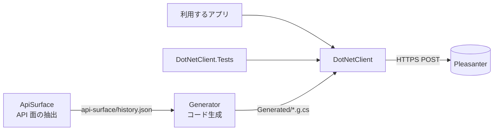

# アーキテクチャ方針

## 位置づけ

Pleasanter の標準 Web API を呼ぶ .NET 向けのクライアントライブラリです（NuGet パッケージ `VehicleVision.PleasanterTools.DotNetClient`）。
ライセンスは LGPL・AGPL・商用の 3 層です（[ライセンス](ライセンス.md)）。Pleasanter 本体のコードは取り込みません。

## 構成

- `DotNetClient`: Pleasanter API クライアントと接続設定。UI や実行形態に依存しない。API ごとのメソッドとモデルは `Generated/` に生成したもの、送受信と版の判定は手書き
- `DotNetClient.Tests`: 単体テスト。通信はフェイク（`HttpMessageHandler`）で差し替える
- `tools/…ApiSurface`: Pleasanter のタグごとのソースから API 面を抽出する（[API 面の抽出](API面の抽出.md)）。配布物に含めない
- `tools/…Generator`: API 面の表からクライアントのコードを生成する（[クライアントの生成と版の判定](クライアントの生成と版の判定.md)）。配布物に含めない

## 決めたこと

- **Pleasanter の事実確認用ソースは必要時に取得する。** Git では追跡せず、読む前に
  `bash scripts/sync-reference.sh` で上流 `main` へ更新する。CI からは取得しない。
  `PLEASANTER_REFERENCE_DIR` を指定した場合は、その場所を直接読む。
  ビルド・NuGet 配布から隔離し、完全な SHA・固定リンク・参照日で根拠を記録する。
  API 面のタグ別抽出は別の一時取得先を維持する（[参照ソース](../_reference/README.md)）
- **API キーはリクエストボディに載せる。** [Context.cs][api-key-source] の `ApiKey` の読み取りを
  SHA `664c833b144d9da9b6bb58e60f7e48eb01141e58` で再確認した（参照日 2026-10-27）。
  キーはサーバ側だけが持つ。例外は `Binaries/upload` で、`Authorization: Bearer` で送る
  （同じ SHA の [BinariesController.cs][upload-source]）。実機（Pleasanter 1.5.9.1）で通ることを確かめた（[契約テスト](契約テスト.md)）
- **`BaseUrl` は通信の前に検査する**（Issue #85）。API キーが本文に載るので、https のみ（ループバック `localhost`・`127.0.0.1`・`[::1]` だけ http 可）、資格情報・クエリ・フラグメントは拒否する（Issue #102: 検証用の環境だけ、`AllowInsecureHttp`〔既定は無効〕でループバック以外の http も許せる。ユーザー決定 2026-11-04）。`PleasanterOptions.Validate()` が行い、クライアントは接続設定を解決するたびに呼ぶ。拒否の文言には API キーも URL も出さない。各アプリが別々に持っていた検査を集めたもの
- **クライアントは再試行しない。** 応答を `PleasanterErrorKind` で分類して返し、再送するかは呼び出し側が決める。応答が返らなかった場合（`Unknown`）は、できたかどうか分からないため照合してから判断する
- **`Retry-After` は読むだけで、待たない・再送しない**（Issue #105。ユーザー決定 2026-11-05）。`PleasanterResponse.RetryAfter`（`TimeSpan?`。`PleasanterBinaryResponse` も同じ）に、HTTP ヘッダの秒指定・HTTP-date の両方を入れる。日時は応答を受け取った時点の `TimeProvider`（既定はシステム時計。テストで差し替える）との差。負・過去は `TimeSpan.Zero`、無い・読めない・応答が返らないときは `null`。**上限の丸めはしない**（待たせる上限は呼び出し側の方針）。ステータスには依らず、ヘッダがあれば読む。`StatusCode`・`ErrorKind` の意味は変えない。MailIngest・FeedIngest の自前の読み方（秒・日時・負は 0・上限なし）に合わせたもので、集約（#83）のとき各アプリが自前の読み取りを消せる
- **環境変数から接続設定を作る `PleasanterOptions.FromEnvironment()` は、共通の `VVPT_PLEASANTER_*`（`BASE_URL`・`API_KEY`・`SERVER_VERSION`・`ALLOW_INSECURE_HTTP`）を読む**（Issue #116。仕様は Core の `_documents/CLIの共通仕様書.md` の 6 章）。
  変数名は、Core の `VehicleVision.PleasanterTools.Core.Contracts`（定数だけで BCL のみに依存する NuGet パッケージ。`Core.Cli` は参照しない）の `PleasanterEnvironmentNames` を使い、重複して持たない。
  旧名（`PLEASANTER_*` の 4 つ）は読まない（設定されていても無視する。Issue #124）。旧名だけの環境は新名が未設定として失敗する（英語・ASCII の文言。値は含めない）。`API_KEY_FILE` は足さず、ツール側が読む。
  契約テストの接続の変数と開発用の変数は改名しない（[契約テスト](契約テスト.md)）
- **リダイレクトを辿らない `HttpClient` の作り方を提供する**（Issue #86）。API キーが本文に載り、既定の `HttpClient` は 307・308 で本文を再送するため。`PleasanterHttp.CreateHandler()`・`CreateClient()` を提供し、クライアントは渡された `HttpClient` の設定を変えない（変えられない）。3xx は `Permanent` で返す。IHttpClientFactory 用の登録拡張は、依存（`Microsoft.Extensions.Http`）を増やさないため置かず、`ConfigurePrimaryHttpMessageHandler(PleasanterHttp.CreateHandler)` を README に書く
- **ランタイムは Pleasanter 本体に揃える。** .NET 10 / net10.0
- **依存は寛容ライセンスに限る。** 3 層（LGPL・AGPL・商用）で提供し続けられるようにするため
- **公開は nuget.org。** タグ `vX.Y.Z` で `release.yml` が公開する（Trusted Publishing。共有の公開用アカウントと組織の変数 `NUGET_ORG_USER`）
- **サポートする Pleasanter は 1.3.0.0 以降**（Issue #70・#72。API 面の表は 1.3.0.0〜1.5.9.0。1.3.x の実機の確認は、Docker Hub にある 1.3.29.0 以降だけが可能で、ほとんど未確認。`ApiVersion` の既定など 1.3.x での食い違いは Issue #73・#74）。 クライアントの .NET とサーバーの .NET は関係しない
- **公開する API は、API 面の表から生成する。** 範囲は、領域 `api` の属性ルーティングのエンドポイントのうち、本文の送り方が分かるもの（Items・Users・Depts・Groups・Binaries・Tenants・Sessions・OutgoingMails・Extensions・Utility・Extended・BackgroundTasks）。
  SCIM・MCP・旧来の `Api_*`・`Demo/Register` は対象外（理由は [クライアントの生成と版の判定](クライアントの生成と版の判定.md)）。生成物はコミットし、CI で最新かを確かめる
- **型は、抽出できたものだけを付ける。** 応答の匿名型（`Response` の中身）は型が取れていないので `JsonElement` のままにし、利用者が読む型を選ぶ
- **接続先の版で使える機能を判定する。** 版は `PleasanterOptions.ServerVersion`、無ければ `api/utility/GetLicenseInfo` の `Response.Version`（1.4.21.0 以降で取れる）。
  使えない機能は送る前に `PleasanterVersionNotSupportedException`。版が不明なら既定は送る（`UnknownServerVersion` で拒否も選べる）
- **版の問い合わせの記憶は、接続先ごとにプロセスで共通にする**（Issue #87）。既定（問い合わせる）は変えない。結論が出た結果（版・版なし・404）はずっと、出なかった結果（到達不能・401・429・5xx・JSON でない 200）は `ServerVersionRetryInterval`（既定 1 分）だけ覚える。
  理由: `AddTransient` で登録するアプリで毎回問い合わせない／失敗を永続的に覚えると、一時的な 5xx で版が不明のままになる／覚えないと到達不能で呼び出しのたびに待ちが倍になる。問い合わせは `ServerVersionTimeout`（既定 10 秒）で切り上げる
- **`ApiVersion` の既定値は `1.1`。** `Implem.Pleasanter/App_Data/Parameters/Api.json` の `Version` で、`Pleasanter_1.4.0.0`〜`Pleasanter_1.5.9.0` の全タグで同じ値（1.3.12.0 以前は `Api.json` に `Version` が無い。Issue #74。参照日 2026-10-21、[API 面の版差](../api-surface/history.md)）

## 未決定

- 実機の Pleasanter に対する動作確認は、最新版（1.5.9.1）の主要な口だけ（[契約テスト](契約テスト.md)、Issue #68）。版ごとの契約テストは Issue #69
- 応答の匿名型を型付けするか（実機の応答から型を決めるなら、契約テストの結果を踏まえる。応答の形は [契約テスト](契約テスト.md) に残した）
- `ApiVersion` の既定値 `1.1` を、Pleasanter の既定が変わったときに追うか
- nuget.org の ID 予約: `VehicleVision` のプレフィックスで予約済み。この ID での初回公開は未実施

[api-key-source]: https://github.com/Implem/Implem.Pleasanter/blob/664c833b144d9da9b6bb58e60f7e48eb01141e58/Implem.Pleasanter/Libraries/Requests/Context.cs#L497-L504
[upload-source]: https://github.com/Implem/Implem.Pleasanter/blob/664c833b144d9da9b6bb58e60f7e48eb01141e58/Implem.Pleasanter/Controllers/Api/BinariesController.cs#L281-L289
