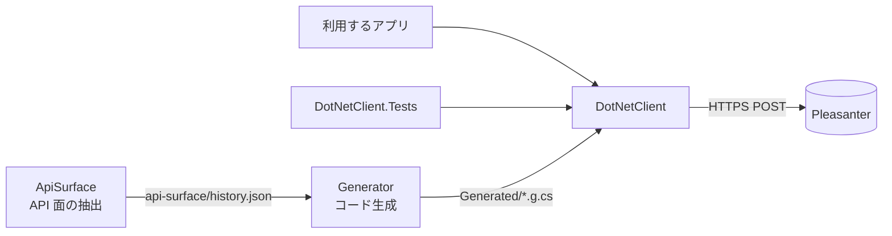

# アーキテクチャ方針

## 位置づけ

Pleasanter の標準 Web API を呼ぶ .NET 向けのクライアントライブラリです（NuGet パッケージ `VehicleVision.PleasanterTools.DotNetClient`）。
ライセンスは LGPL-3.0-or-later です（[ライセンス](ライセンス.md)）。Pleasanter 本体のコードは取り込みません。

## 構成

- `DotNetClient`: Pleasanter API クライアントと接続設定。UI や実行形態に依存しない。API ごとのメソッドとモデルは `Generated/` に生成したもの、送受信と版の判定は手書き
- `DotNetClient.Tests`: 単体テスト。通信はフェイク（`HttpMessageHandler`）で差し替える
- `tools/…ApiSurface`: Pleasanter のタグごとのソースから API 面を抽出する（[API 面の抽出](API面の抽出.md)）。配布物に含めない
- `tools/…Generator`: API 面の表からクライアントのコードを生成する（[クライアントの生成と版の判定](クライアントの生成と版の判定.md)）。配布物に含めない

## 決めたこと

- **Pleasanter の事実確認用ソースは必要時に取得する。** Git では追跡せず、読む前に
  `bash scripts/sync-reference.sh` で上流 `main` へ更新する。CI からは取得しない。
  `PLEASANTER_REFERENCE_DIR` を指定した場合は、その場所を直接読む。
  ビルド・NuGet 配布から隔離し、完全な SHA・固定リンク・参照日で根拠を記録する。
  API 面のタグ別抽出は別の一時取得先を維持する（[参照ソース](../_reference/README.md)）
- **API キーはリクエストボディに載せる。** [Context.cs][api-key-source] の `ApiKey` の読み取りを
  SHA `664c833b144d9da9b6bb58e60f7e48eb01141e58` で再確認した（参照日 2026-10-27）。
  キーはサーバ側だけが持つ。例外は `Binaries/upload` で、`Authorization: Bearer` で送る
  （同じ SHA の [BinariesController.cs][upload-source]）。実機の応答は未検証
- **クライアントは再試行しない。** 応答を `PleasanterErrorKind` で分類して返し、再送するかは呼び出し側が決める。応答が返らなかった場合（`Unknown`）は、できたかどうか分からないため照合してから判断する
- **ランタイムは Pleasanter 本体に揃える。** .NET 10 / net10.0
- **依存は寛容ライセンスに限る。** 利用者が LGPL のまま使えるようにするため
- **公開は nuget.org。** タグ `vX.Y.Z` で `release.yml` が公開する（Trusted Publishing。共有の公開用アカウントと組織の変数 `NUGET_ORG_USER`）
- **サポートする Pleasanter は 1.4.0.0 以降。** クライアントの .NET とサーバーの .NET は関係しない
- **公開する API は、API 面の表から生成する。** 範囲は、領域 `api` の属性ルーティングのエンドポイントのうち、本文の送り方が分かるもの（Items・Users・Depts・Groups・Binaries・Tenants・Sessions・OutgoingMails・Extensions・Utility・Extended・BackgroundTasks）。
  SCIM・MCP・旧来の `Api_*`・`Demo/Register` は対象外（理由は [クライアントの生成と版の判定](クライアントの生成と版の判定.md)）。生成物はコミットし、CI で最新かを確かめる
- **型は、抽出できたものだけを付ける。** 応答の匿名型（`Response` の中身）は型が取れていないので `JsonElement` のままにし、利用者が読む型を選ぶ
- **接続先の版で使える機能を判定する。** 版は `PleasanterOptions.ServerVersion`、無ければ `api/utility/GetLicenseInfo` の `Response.Version`（1.4.21.0 以降で取れる）。
  使えない機能は送る前に `PleasanterVersionNotSupportedException`。版が不明なら既定は送る（`UnknownServerVersion` で拒否も選べる）
- **`ApiVersion` の既定値は `1.1`。** `Implem.Pleasanter/App_Data/Parameters/Api.json` の `Version` で、`Pleasanter_1.4.0.0`〜`Pleasanter_1.5.9.0` の全タグで同じ値（参照日 2026-10-21、[API 面の版差](../api-surface/history.md)）

## 未決定

- 実機の Pleasanter に対する動作確認は行っていない（単体テストはフェイクのみ）。版ごとの契約テスト（Docker）はフェーズ 3 で行う
- 応答の匿名型を型付けするか（実機の応答から型を決めるなら、フェーズ 3 の結果を待つ）
- `ApiVersion` の既定値 `1.1` を、Pleasanter の既定が変わったときに追うか
- nuget.org の ID 予約: `VehicleVision` のプレフィックスで予約済み。この ID での初回公開は未実施

[api-key-source]: https://github.com/Implem/Implem.Pleasanter/blob/664c833b144d9da9b6bb58e60f7e48eb01141e58/Implem.Pleasanter/Libraries/Requests/Context.cs#L497-L504
[upload-source]: https://github.com/Implem/Implem.Pleasanter/blob/664c833b144d9da9b6bb58e60f7e48eb01141e58/Implem.Pleasanter/Controllers/Api/BinariesController.cs#L281-L289
