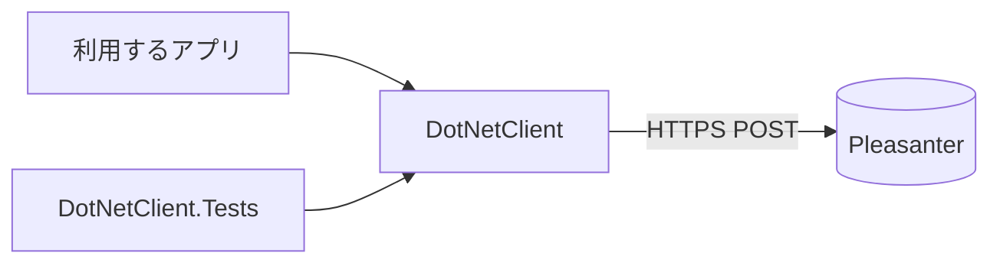

# アーキテクチャ方針

## 位置づけ

Pleasanter の標準 Web API を呼ぶ .NET 向けのクライアントライブラリです（NuGet パッケージ `VehicleVision.PleasanterTools.DotNetClient`）。
ライセンスは LGPL-3.0-or-later です（[ライセンス](ライセンス.md)）。Pleasanter 本体のコードは取り込みません。

## 構成

- `DotNetClient`: Pleasanter API クライアントと接続設定。UI や実行形態に依存しない
- `DotNetClient.Tests`: 単体テスト。通信はスタブで差し替える

## 決めたこと

- **API キーはリクエストボディに載せる。** Pleasanter にヘッダ方式は無い。根拠は `_reference/Implem.Pleasanter` の `Implem.Pleasanter/Libraries/Requests/Context.cs`（参照日 2026-10-12、固定位置 `Pleasanter_1.5.8.1`）。
  そのためブラウザから直接 API を叩く設計にはできず、キーはサーバ側だけが持つ
- **クライアントは再試行しない。** 応答を `PleasanterErrorKind` で分類して返し、再送するかは呼び出し側が決める。応答が返らなかった場合（`Unknown`）は、できたかどうか分からないため照合してから判断する
- **ランタイムは Pleasanter 本体に揃える。** .NET 10 / net10.0
- **依存は寛容ライセンスに限る。** 利用者が LGPL のまま使えるようにするため
- **公開は nuget.org。** タグ `vX.Y.Z` で `release.yml` が公開する（Trusted Publishing。共有の公開用アカウントと組織の変数 `NUGET_ORG_USER`）

## 未決定

- 公開する API の範囲（レコードの作成・更新・削除・取得・一括、サイトの設定、ユーザ・組織・グループなど）と、型付きの扱い。
  版ごとの API 面は [API 面の抽出](API面の抽出.md) で機械的に抽出している（対象は 1.4.0.0 以降。ソースからの抽出で、実機では確かめていない）
- `ApiVersion` の既定値 `1.1` は、`Implem.Pleasanter/App_Data/Parameters/Api.json` の `Version` で、`Pleasanter_1.4.0.0`〜`Pleasanter_1.5.9.0` の全タグで同じ値（参照日 2026-10-21、[API 面の版差](../api-surface/history.md)）。クライアントの既定値をこれに合わせ続けるかは未決定
- 実機の Pleasanter に対する動作確認は行っていない（単体テストはスタブのみ）
- nuget.org の ID 予約: `VehicleVision` のプレフィックスで予約済み。この ID での初回公開は未実施
