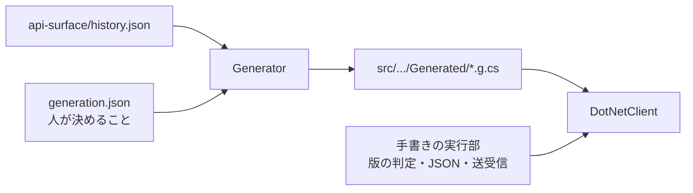

# クライアントの生成と版の判定

Issue #20（フェーズ 2）の設計。[API 面の抽出](API面の抽出.md)（フェーズ 1）が作った `api-surface/history.json` から、
リクエスト・応答のモデルとクライアントのメソッドを**コード生成**し、接続先の Pleasanter の版で、使える機能かを判定する。

- **ソースからの抽出と、それをもとにした生成であり、実機の Pleasanter では確かめていない。** 単体テストは `HttpMessageHandler` のフェイクだけで行う。実機での確認はフェーズ 3（版ごとの契約テスト）
- サポートする Pleasanter は **1.4.0.0 以降**。クライアントの .NET とサーバーの .NET は関係しない

## サーバーの版の取得（調査結果）

出典: <https://github.com/Implem/Implem.Pleasanter> のタグ `Pleasanter_1.4.0.0`〜`Pleasanter_1.5.9.0`（66 タグ）。参照日 2026-10-21。パスは `Implem.Pleasanter/` からの相対。

| 版 | 取れるか | 根拠 |
| --- | --- | --- |
| 1.4.21.0〜1.5.9.0 | **取れる**。`POST api/utility/GetLicenseInfo` の応答の `Response.Version` | `Libraries/License/LicenseUtilities.cs` の `GetLicenseInfo` が `Version = Environments.AssemblyVersion` を返す。1.4.21.0 で初めて現れ、1.5.9.0 まで全タグにある |
| 1.4.13.0〜1.4.20.0 | **取れない**。同じ口はあるが、応答に `Version` が無い（`CommercialLicense`・`LicenseDeadline`・`Environment` だけ） | `Controllers/Api/UtilityController.cs` が応答を直接組み立てている（例: `Pleasanter_1.4.20.0`） |
| 1.4.0.0〜1.4.12.0 | **取れない**。`api/utility/GetLicenseInfo` が無い | `Controllers/Api/UtilityController.cs` が無い（`api-surface/history.md` でも Since 1.4.13.0） |

- `Environments.AssemblyVersion` は `Startup.cs` で `Assembly.GetExecutingAssembly().GetName().Version.ToString()` から設定される（全 66 タグで同じ）。
  `Implem.Pleasanter.csproj` の `<AssemblyVersion>` は、全 66 タグでタグ名の版と一致した（例: `Pleasanter_1.5.9.0` → `1.5.9.0`）。**自分でビルドした版や改変版では一致しないことがある**
- `api/utility/GetLicenseInfo` は認証が要る（`context.Authenticated` を確かめる）。API キーが要り、1.5.6.0 からはレート制限 `Api` の対象。1 日の API 回数の上限に数えられるかは確かめていない
- **ヘッダでは取れない。** API の応答に版を載せるヘッダは無い（`Startup.cs` のヘッダは `X-Frame-Options` など。1.4.0.0・1.4.20.0・1.5.9.0 で確認）
- ほかの口も調べたが、使わない
  - `/versions`（`Controllers/VersionsController.cs`）: 画面（HTML）で、`[Authorize]`（ログインのクッキー）が要る。API キーでは読めない
  - CSS・JS の URL のキャッシュ回避の値（`Libraries/HtmlParts/HtmlStyles.cs`）: テーマの版と版を `.` を除いてつないだもので、元の版へ戻せない
  - サイトパッケージ（`Libraries/SitePackages/SitePackage.cs` の `AssemblyVersion`）: 取り出す API が無い（`CopySitePackage` は取り込み側）
- **エンドポイントの有無からの推定は採らない。** 例えば「`GetLicenseInfo` があり `Version` が無いなら 1.4.13.0〜1.4.20.0」と言えるが、
  404 はリバースプロキシや設定でも起き、区間の判定は利用者に分かりにくい。必要になったら別 Issue で検討する

### 結論

**1.4.21.0 以降は自動で取れる。1.4.0.0〜1.4.20.0 は取れない**ので、利用者が `PleasanterOptions.ServerVersion` で明示する。

## 版の判定

### 版の決め方

1. `PleasanterOptions.ServerVersion`（`Version?`）があれば、それを使う（問い合わせない）
2. 無く、`PleasanterOptions.DetectServerVersion`（既定 `true`）なら、最初の API 呼び出しの前に `api/utility/GetLicenseInfo` を 1 回呼び、`Response.Version` を読む
   - 取れた版は、接続先（`BaseUrl`）ごとにクライアントの中で覚える。`RefreshServerVersionAsync` でやり直せる
   - 応答が 200 で `Version` が無い・404・401 などは「版が不明」とし、覚える（同じ問い合わせを繰り返さない）
   - 通信の失敗（応答が返らない）は覚えない（次の呼び出しでもう一度試す）
3. それ以外は「版が不明」

### Since・Until の意味

- `[Since("x.y.z.w")]`: その版から在る。**`1.4.0.0` は「1.4.0.0 以前から在る」**（対象の最初の版のため）
- `[Until("x.y.z.w")]`: その版からは無い（排他）。付いていなければ最新の版（1.5.9.0）まで在る
- 版の比較は 4 つの数の順（`System.Version`）

### 判定するところ

| 対象 | 判定 | 使えないとき |
| --- | --- | --- |
| メソッド（エンドポイント） | 送る前に、エンドポイントの Since・Until | `PleasanterVersionNotSupportedException` を投げ、送らない |
| モデルのメンバー | JSON へ書くときに、**値が入っている（null でない）**メンバーの Since・Until | 同上（送らない） |
| 列挙値 | JSON へ書くときに、列挙のメンバーの Since・Until | 同上 |

### 版が不明のとき

`PleasanterOptions.UnknownServerVersion` で選ぶ。

- **`Attempt`（既定）: 拒否せず送る。** 1.4.0.0〜1.4.20.0 は自動で版が取れないため、拒否を既定にすると、`ServerVersion` を書かない限り何も呼べなくなる。
  送った結果、サーバーに無いエンドポイントは 404、無いメンバーは**黙って無視される**（Pleasanter は Newtonsoft.Json の既定の設定で本文を読み、知らないメンバーを捨てる。`Implem.Libraries/Utilities/Jsons.cs` の `Deserialize`）
- `Reject`: 版を問わず使えるもの（Since が 1.4.0.0 で Until が無い）以外は、例外を投げて送らない

### 例外

`PleasanterVersionNotSupportedException`（`InvalidOperationException` の派生）。

- `Member`: 何が使えないか（例: `Items.MoveSiteAsync`・`Api.SsCache`・`DataChange.Types.InputValueFormula`）
- `Since`・`Until`: その機能が在る版の範囲
- `ServerVersion`: 判定に使ったサーバーの版。不明なら `null`（`Reject` のとき）

HTTP の失敗（401・404・500 など）は、これまでどおり例外にせず、`PleasanterErrorKind` で分類して返す。

## 生成の仕組み



- 生成器: `tools/VehicleVision.PleasanterTools.DotNetClient.Generator`（配布物に含めない。依存は .NET の標準ライブラリだけ）
- 人が決めること: `tools/VehicleVision.PleasanterTools.DotNetClient.Generator/generation.json`（対象外の一覧と理由・名前の変更の対応・レコードの種類の型・クライアントが入れるメンバー）
- 出力: `src/VehicleVision.PleasanterTools.DotNetClient/Generated/`。**コミットする**（再現性のため。生成器を通さずに中身を確かめられる）
- 生成物には、識別子・型名・パス・版という事実だけを入れる。Pleasanter のソースの文章・コード・コメントは入れない。型の出典は `Implem.` を除いた名前（例: `Pleasanter.Models.IssueApiModel`）で書く

```bash
# 生成する
dotnet run --project tools/VehicleVision.PleasanterTools.DotNetClient.Generator -- generate
# 生成物が最新かを確かめる（差分があれば終了コード 1）。CI と単体テストでも確かめる
dotnet run --project tools/VehicleVision.PleasanterTools.DotNetClient.Generator -- check
```

API 面の表（`api-surface/`）を更新したら、`generate` をやり直してコミットする。
Windows で長いパスの作業ツリーから実行できない（コード整合性のポリシーで止まる）ときは、短いパスへ複製してビルドし、`generate --root <作業ツリー>` で書き戻す。

### 生成物の構成（2026-10-21、1.4.0.0〜1.5.9.0 の表から）

| 場所 | 中身 |
| --- | --- |
| `Generated/Operations/{コントローラ}Operations.g.cs` | API のメソッド。12 のコントローラ、58 エンドポイント、72 メソッド（多重定義を含む） |
| `Generated/Models/*.g.cs` | リクエスト・応答のモデル。127 型（クラス 79・列挙 48。入れ子を含む） |
| `Generated/Responses/*.g.cs` | 包みの `Response`（型付けしていない）。6 種 |
| `Generated/PleasanterApiClient.g.cs` | `client.Items` などの入口 |
| `Generated/GeneratedSurface.g.cs` | 表の範囲（`FirstVersion`・`LatestVersion`）と、対象外のエンドポイントと理由（`Excluded`） |

### 生成のために history.json の粒度を足したこと

フェーズ 1 の抽出では、値を書いていない列挙のメンバーの数値が `null` で、宣言の順も失われていた。また、`List<T>` を継承する型の基底が、型引数の型として記録されていた。
コード生成に要るので、抽出を直して再生成した（[API 面の抽出](API面の抽出.md) の「抽出の規則」）。
その結果、`DataChange.Types` の `InputDate` などの数値が 1.4.10.0 で変わる（`InputValueFormula` が途中に入った）ことが分かった。

## 公開する API（主なもの）

| 型・メンバー | 役割 |
| --- | --- |
| `PleasanterApiClient` | 入口。`Items`・`Users`・`Depts`・`Groups`・`Binaries`・`Tenants`・`Sessions`・`OutgoingMails`・`Extensions`・`Utility`・`Extended`・`BackgroundTasks` |
| `PleasanterApiClient.GetServerVersionAsync`・`RefreshServerVersionAsync` | 接続先の版（不明なら `null`） |
| `PleasanterApiClient.DeserializeAsync<T>` | 型付けしていない値（`JsonElement`）を、版に合わせて利用者が選んだ型へ読む |
| `PleasanterApiClient.PostJsonAsync` | 型付けしない呼び出し（`ApiKey`・`ApiVersion` だけ入れる。版の判定はしない） |
| `PleasanterApiClient.CheckConnectionAsync` | 到達とキーの確認 |
| `client.Items.GetAsync`・`CreateAsync`・`UpdateAsync`・`UpsertAsync`・`DeleteAsync`・`BulkDeleteAsync`・`BulkUpsertAsync`・`ImportAsync`・`ExportAsync` | レコード |
| `client.Items.GetSiteAsync`・`CreateSiteAsync`・`UpdateSiteAsync`・`DeleteSiteAsync`・`UpdateSiteSettingsAsync`・`CopySitePackageAsync`・`SynchronizeSummariesAsync`・`MoveSiteAsync`・`GetClosestSiteIdAsync` | サイト |
| `client.Users`・`Depts`・`Groups` の `GetAsync`・`CreateAsync`・`UpdateAsync`・`DeleteAsync`・`ImportAsync` | ユーザー・組織・グループ |
| `client.Binaries.GetAsync`・`GetStreamAsync`・`UploadAsync` | 添付ファイル |
| `PleasanterOptions.ServerVersion`・`DetectServerVersion`・`UnknownServerVersion` | 版の指定・問い合わせ・不明のときの振る舞い |
| `PleasanterResponse`・`PleasanterResponse<T>`・`PleasanterEnvelope<T>`・`PleasanterBinaryResponse`・`PleasanterFile` | 結果と送るファイル |
| `PleasanterVersionNotSupportedException`・`SinceAttribute`・`UntilAttribute`・`RenamedFromAttribute`・`ValueBeforeAttribute` | 版の判定 |
| `VehicleVision.PleasanterTools.DotNetClient.Models` | 生成したモデル（`IssueApiModel`・`Api`・`View`・`SiteSettings` など） |

### 生成の規則

| 対象 | 規則 |
| --- | --- |
| 対象のエンドポイント | 領域 `api` で、パスが分かるもの（属性ルーティング）。`generation.json` の対象外を除く |
| まとめ方 | コントローラごとのクラス（`ItemsController` → `client.Items`、型 `ItemsOperations`）。`…Api` にしないのは、Pleasanter の型 `ExtendedApi` と重なるため |
| メソッド名 | アクション名 + `Async`。同じアクションに複数のルートがあれば多重定義（`Users.GetAsync()` と `Users.GetAsync(int id)`） |
| 引数 | ルートの引数（型は history のとおり）→ 本文の型 → クエリ文字列・フォーム → `CancellationToken`。ルートに無い引数（`notInTemplate`）は出さない（その値を取るルートのほうを使う） |
| `{controller}` | ルートのテンプレートの `{controller}` は、ASP.NET の規則でコントローラ名（`OutgoingMails`）に置き換える |
| 本文（JSON） | `requestTypes` の型を、**同じ本文として重ねて**送る（Pleasanter は同じ本文を複数の型で読むため）。ただし、レコードの種類の型（`IssueApiModel`・`ResultApiModel`・`SiteApiModel`・`WikiApiModel`・`…BulkUpsertApiModel`）は、どれか 1 つを選ぶ多重定義にする |
| `ApiKey`・`ApiVersion` | モデルに出さず、クライアントが本文へ入れる（`ApiVersion` の既定 1.1 は `parameter:Api.Version` と同じ） |
| 本文（フォーム） | 入力の手がかりが `Request.Form[parameters]` とファイルなら、`parameters` に JSON、ファイルを添付（`Import`）。`Authorization` ヘッダとファイルなら、`Authorization: Bearer <ApiKey>` とファイル・フォームの値（`Binaries/upload`） |
| 応答 | `FileStreamResult` を返すもの → バイト列。`ApiResults.Get(response: new { … })` のメンバー名が取れたもの → 包み（`StatusCode`・`LimitPerDate`・`LimitRemaining`・`Response`）と、メンバー名だけの型。それ以外 → 型付けしない JSON（`JsonNode`） |
| モデル | 対象のエンドポイントのリクエストの型・応答の手がかりの型・`ApiResponse` から、メンバーの型をたどって生成する。継承も同じ形にする（インターフェースは出さない） |
| メンバー | **すべて null を取れる型**にし、null は送らない。サーバー側の既定値はサーバーに任せる（`Offset` を 0 で送るなどして、意図しない値を送らないため） |
| 送らないメンバー | `[NonSerialized]`・`[JsonIgnore]`・`[IgnoreDataMember]` のメンバーは出さない |
| JSON の名前 | メンバー名のまま（`[JsonProperty(PropertyName = "x")]` があれば `x`）。読むときは大文字小文字を区別しない |
| 列挙 | 書くときは**名前**（`"asc"`・`"Deleted"`）。名前の無い値（`Permissions.Types` の組み合わせなど）は数値。読むときは名前と数値の両方を受ける。数値が版で変わったもの（`DataChange.Types`、1.4.10.0）は、サーバーの版に合わせて読む（`[ValueBefore]`） |
| `List<T>` を継承する型 | `Attachments`・`Lookups`・`LinkActions`・`Join`・`SettingList<T>` などは `List<T>` として扱う（Newtonsoft.Json は配列として読み書きする。`Join` の自前のメンバーは JSON に出ない） |
| 型の名前 | 単純名。先頭の `_` は外す（`_BaseApiModel` → `BaseApiModel`）。外側の型も生成するなら入れ子にする（`View.ApiDataTypes`）。外側を生成しない型は単純名にし、名前が重なるか `Types` のときだけ外側の名前を前に付ける（`Sqls.TableTypes` → `TableTypes`、`SqlOrderBy.Types` → `SqlOrderByTypes`、`Permissions.Types` → `PermissionsTypes`）。手書きの部分（`PleasanterOptions` など）と重なれば生成を止める |

列挙を名前で書くのは、数値が版で変わることがある（上記）のに対し、名前は変わっていないため。
Pleasanter は Newtonsoft.Json の既定の設定で読むので、名前（大文字小文字を問わない）も数値も受け付ける（**実機では確かめていない**）。
Pleasanter 自身も、一部の列挙（`SqlOrderBy.Types`・`DataChange.Types`・`StatusControl.ControlConstraintsTypes` など）に `[JsonConverter(…)]` を付けている（history.json の属性。引数は未抽出で、名前で書くかどうかまでは確かめていない）。

## 名前の変更の扱い

history.json では、名前の変更は「旧い名前の廃止（Until）」と「新しい名前の導入（Since）」として現れる。対応づけは人が判断し、`generation.json` の `renames` に書く。
生成器は、旧い名前の Until と新しい名前の Since が同じ版であることを確かめ、合わなければ生成を止める。

| 型 | 旧い名前 | 新しい名前 | 変わった版 |
| --- | --- | --- | --- |
| `Pleasanter.Libraries.DataTypes.Attachment` | `Extention` | `Extension` | 1.4.7.0 |

- モデルは**新しい名前に統一**する（`Attachment.Extension`）
- サーバーの版が分かり、変わる前（1.4.7.0 より前）なら、旧い名前で書く・読む
- 版が不明なら、**両方の名前で書き**、どちらの名前でも読む（知らない名前はサーバーが無視するので、どの版でも通る）

1.4.0.0〜1.5.9.0 の history.json で、Until を持つメンバーはほかに `SiteSettings` の `ItemPermissionType`・`PermissionType`・`PermissionTypeCache`（1.5.6.0 で廃止）があるが、
同じ版に対応する新しいメンバーが無く、名前の変更ではない（廃止として扱う）。

## 対象外

| 対象 | 理由 |
| --- | --- |
| SCIM（`scim/v2/*`、17 エンドポイント） | 本文の型が history.json に無い（`…ByApi` の形を取らないため未抽出）。認証も別（`CheckScimContextAttributes`） |
| MCP サーバ（1.5.2.0〜） | history.json の対象外（コントローラの形をしていない、別の規格の口） |
| 旧来の `Api_*` コントローラ（7 エンドポイント） | URL が分からない（規約ルーティングのどれに当たるかを確かめていない） |
| `POST api/demo/register` | デモ環境の利用登録の口で、設定（`Parameters.Service.DemoApi`）で有効なときだけ動く。本文の型も取れていない |
| `Binaries/upload` の分割送信（`Content-Range`） | 1 回で送る形だけを生成する。分割の手順（セッションに途中の状態を持つ）は history.json に無い |

一覧は `generation.json` にもあり、生成器は、history.json のエンドポイントがすべて「生成する」か「対象外（理由つき）」のどちらかになっていることを確かめる。

## 型が取れていない部分

推測で型を決めない。取れていないものは、汎用の受け皿にして、生成物のコメントにも書く。

| 部分 | 扱い |
| --- | --- |
| 応答の匿名型（`Response` の `Offset`・`PageSize`・`TotalCount`・`Data` など） | メンバー名だけが取れている。各メンバーは `JsonElement?`。`Data` の要素の型の手がかり（`modelTypes`、例: `IssueApiModel`）はコメントに書き、読むときは `client.DeserializeAsync<T>(element)` で利用者が型を選ぶ（接続先の版に合わせて、名前の変更・列挙の数値を読み替える） |
| `Response` 以外の形で返す応答（`Users/Get`・`Sessions/Get`・`Binaries/{guid}/Get`・`Utility/GetLicenseInfo` など） | 型付けしない（`PleasanterResponse.Body` の `JsonNode`）。成功・失敗の `Id`・`Message` は `ApiResponse` の名前で読む |
| `object`・`dynamic` のメンバー | `object?`（読むと `JsonElement`） |
| `Dictionary<object, object>` | `Dictionary<string, object?>`（JSON のキーは文字列のため） |
| ソースで型が見つからないメンバー | `JsonElement?`（1.4.0.0〜1.5.9.0 では、送らないメンバーにしか無い） |
| `requestTypes` が空のエンドポイント（`Items/{id}/Delete` など） | 本文は `ApiKey`・`ApiVersion` だけ。辿った処理が本文を型として読んでいない、という意味で、ほかの読み方をしていないことまでは確かめていない（`Items/{id}/Delete` だけは手で確かめた） |

型付けしていないエンドポイントや、生成の対象外の口は、`PleasanterApiClient.PostJsonAsync(path, body)` で呼べる（`ApiKey`・`ApiVersion` だけを入れて送る）。

## 未確認の点

- 実機の Pleasanter では、何も確かめていない（URL・本文・応答の形・列挙を名前で送ること・`{controller}` の置き換え・`OutgoingMails` の `{reference}` に入れる値）
- クエリ文字列の真偽値を `true`・`false` で送って、Pleasanter が読めるか
- `Binaries/{guid}/getstream` が失敗したときの応答（認証に失敗・ファイルが無いと、コントローラは null を返す。中身の無い応答は失敗として扱っている）
- `Import`・`Binaries/upload` のファイルの部品の名前（`file` で送っている。コントローラは `Request.Form.Files` を名前によらず読む）
- `GetLicenseInfo` が、1 日の API 回数の上限（`LimitPerDate`）に数えられるか
- 改変版・独自ビルドの Pleasanter で、`Version` がタグの版と一致するか
- 1.4.0.0 より前の版（サポート外）では、Since が 1.4.0.0 のものを止めない（抽出していないので分からない）
